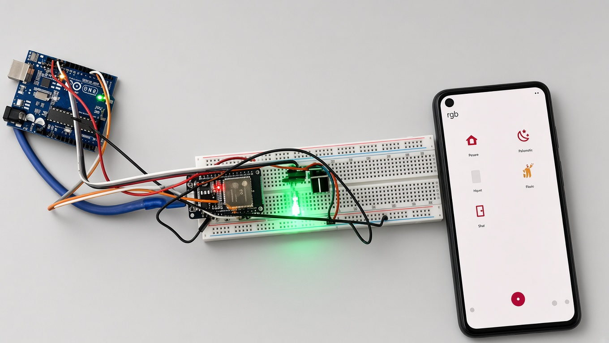
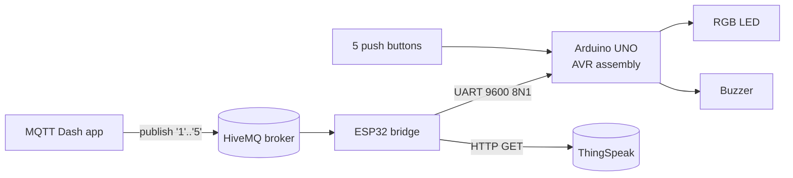

# ChromaLink IoT

An RGB lighting controller built on an **Arduino UNO (ATmega328P)** and an **ESP32**. You can pick a color with physical push buttons or from a phone over MQTT, and every change is logged to the cloud on ThingSpeak.

The firmware on the UNO is written in **AVR assembly**. I first built this as my Computer Organization & Assembly Language semester project in December 2023. I lost the original source along with my laptop, so this repository is a clean rewrite (2026) of the system shown in my demo video below.



**Demo video:** [docs/media/demo.mp4](docs/media/demo.mp4)

## Features

- **Five modes:** yellow, magenta, white, a color cycle, and off
- **Two input paths at once:** 5 push buttons, or the MQTT Dash phone app through the ESP32
- **Startup sequence:** a 3 s buzzer beep, then all LEDs light for 2 s as a self-test
- **Non-blocking timing:** Timer1 runs in CTC mode with a 10 ms tick and is polled without interrupts, so input is never ignored while the color cycle runs
- **Cloud logging:** the ESP32 pushes the R/G/B/cycle state to ThingSpeak and respects the free tier's 15 s rate limit
- **Credentials stay out of git:** they live in a local `config.h`

## Architecture



| Command | Button | Mode |
|---|---|---|
| `1` | D2 | Yellow |
| `2` | D3 | Magenta |
| `3` | D4 | White |
| `4` | D5 | Color cycle (R → G → B → Y → C → M → W → off, 500 ms each) |
| `5` | D6 | Off |

## Wiring

| Part | Arduino UNO pin | AVR port |
|---|---|---|
| RGB LED red (through 100 Ω) | D9 | PB1 |
| RGB LED green | D10 | PB2 |
| RGB LED blue | D11 | PB3 |
| Buzzer | D12 | PB4 |
| Buttons (to GND) | D2 – D6 | PD2 – PD6 |
| ESP32 GPIO17 (TX2) | D0 (RX) | PD0 |
| GND | GND | — |

The buttons use the internal pull-ups, so they need no external resistors.

## Repository layout

```
firmware/
  avr-asm/main.asm                     UNO firmware (AVR assembly, ATmega328P)
  arduino-c/chromalink_iot/         Same behavior in Arduino C, for quick testing
  esp32/chromalink_iot_esp32/       MQTT → UART bridge + ThingSpeak logger
docs/media/                            Demo video and build photo
```

## Getting started

### UNO (assembly)

1. Open `firmware/avr-asm/main.asm` in Microchip Studio, or assemble it with `avra`.
2. Flash the `.hex` file with `avrdude`:
   ```sh
   avrdude -c arduino -p m328p -P <port> -b 115200 -U flash:w:main.hex
   ```
   Disconnect the ESP32 from D0 while you flash.

You can also flash `firmware/arduino-c/chromalink_iot` from the Arduino IDE.

### ESP32

1. Install the **PubSubClient** library.
2. Copy `config.example.h` to `config.h`, then fill in your Wi-Fi details, MQTT topic and ThingSpeak write key.
3. Flash `chromalink_iot_esp32.ino` with the ESP32 board package.
4. In MQTT Dash, add five buttons that publish `1` to `5` to your topic.

## What I learned

- Driving GPIO directly with `SBI`/`CBI`/`SBIS`, and running a state machine in assembly
- Configuring Timer1 CTC and the USART registers on the ATmega328P without the Arduino core
- Using flash lookup tables (`LPM`) to replace long branch chains
- Bridging MQTT to a microcontroller over UART, and working within cloud API rate limits
# Chroma-Link-IoT
